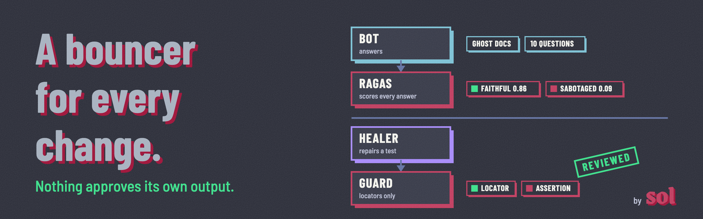

<p align="center"></p>

# rag-bouncer

A small support assistant for [Ghost](https://github.com/TryGhost/Ghost)'s self-hosting docs, and two bouncers that decide what gets through:

1. **An eval gate.** [Ragas](https://github.com/explodinggradients/ragas) scores the assistant's answers on every pull request. If a score drops below its threshold, the pull request stays red.
2. **A healing guard.** When a test breaks because the UI changed, a healer (Playwright's healer agent, or a person) may repair it. The guard accepts the repair only if it changes how an element is found, never what the test asserts.

Both follow one rule: the component that produced a result does not get to approve it.

## The eval gate

```
pull request → GitHub Actions → eval/gate.py → the bot answers 10 questions
             → Ragas scores the answers → below threshold? exit 1, the check goes red
```

| file | what it does |
|---|---|
| [eval/dataset.jsonl](eval/dataset.jsonl) | 10 questions, each with a reference answer paraphrased from one docs page, and the link to that page |
| [eval/thresholds.json](eval/thresholds.json) | the minimum mean score per metric |
| [eval/gate.py](eval/gate.py) | runs the bot, scores it with Ragas, exits 0 (pass), 1 (quality regression) or 2 (judge unavailable) |
| [.github/workflows/eval-gate.yml](.github/workflows/eval-gate.yml) | runs the gate on pull requests that touch the bot or the eval |

Two metrics, both scored by an LLM judge:

- **faithfulness**: the share of claims in the answer that the retrieved docs support. Low means the bot is making things up.
- **context recall**: the share of the reference answer that the retrieved docs cover. Low means search is missing the right page.

**The gate has been seen red.** `python eval/gate.py --sabotage` swaps the bot's prompt for one that ignores the docs, and feeds it the least relevant pages. That is a realistic regression: someone edits a prompt.

Measured on 2026-10-13 with the bot and the judge on Mistral's free tier (`ministral-14b-latest`), 10 questions:

| run | faithfulness | context recall | gate |
|---|---|---|---|
| normal bot | 0.86 | 0.90 | green, exit 0 |
| sabotaged bot | 0.09 | 0.03 | red, exit 1 |

The thresholds are 0.7 for both metrics. The normal run also shows a real weakness: on the image upload question, context recall is 0.00. Keyword search ranked the configuration page above the page that has the answer. The mean still passes. Per-case scores are printed so a weak case is visible even when the gate is green.

Exit code 2 exists so that a free-tier quota error is never read as a quality verdict.

A red check only blocks a merge if it is marked as required: Settings → Branches → Require status checks to pass.

## The healing guard

[healing/guard.py](healing/guard.py) reads the diff a healer produced. It masks every locator expression (`page.getByRole(...)`, `page.locator(...)` and their chains) and compares each changed line before and after. If anything outside a locator changed, the repair is rejected.

Two real repairs, from this repo's own test after the "Ask" button was renamed "Send":

- [accepted-locator-repair.diff](healing/examples/accepted-locator-repair.diff): the locator now looks for "Send". **Accepted.**
- [rejected-weakened-assertion.diff](healing/examples/rejected-weakened-assertion.diff): `toContainText('MySQL 8')` became `toBeVisible()`, so the test would pass without checking the answer. **Rejected.**

It also rejects added or deleted lines, and any test switched to `skip`, `fixme` or `only`. In CI it runs on branches named `heal/*` and keeps a log of every accepted repair.

The guard imports nothing from the rest of the repo. Copy `healing/guard.py` into any Playwright project.

**What it cannot catch:** a locator repaired to point at a broader element. `expect(page.locator('body')).toContainText('MySQL')` passes the guard and proves much less. A human still reviews the repair; the guard narrows what that review has to look at.

## Run it

Locally, for free, with [Ollama](https://ollama.com):

```bash
python -m venv .venv && .venv/bin/pip install -r requirements.txt
ollama pull gpt-oss:20b
.venv/bin/python -m bot ask "Which database does Ghost support in production?"
.venv/bin/python eval/gate.py
.venv/bin/python eval/gate.py --sabotage   # should exit 1
npm ci && npx playwright install chromium && npx playwright test
```

In CI, the bot and the judge run on [Mistral](https://mistral.ai)'s free tier. Add a `MISTRAL_API_KEY` repository secret.

## Why the docs are fetched, not copied

Ghost's code is MIT-licensed, but [its documentation is not openly licensed](https://github.com/TryGhost/Docs/blob/main/LICENSE.md). So this repo never contains it. [bot/corpus.py](bot/corpus.py) downloads 26 pages from GitHub, pinned to one commit of TryGhost/Docs. Pinning also keeps the gate stable: a score moves when the bot changes, not when Ghost edits a page. The CI logs print scores only, never excerpts. Reference answers in the golden set are paraphrased, never quoted.

## What it is not

- **Not a production assistant.** Keyword search (BM25), 26 pages, 10 questions. The point is the gate around it.
- **Not a calibrated judge.** The LLM judge has not been checked against human-labelled scores yet. Until it is, a pass means "the judge saw no regression", not "the answers are right".
- **Not affiliated with Ghost.**

## Related work

- [agentic-e2e-method](https://github.com/missyeahhh/agentic-e2e-method): a method for end-to-end testing where no component validates its own output. The healing guard is the boundary its decision D6 describes, built.
- [Customer support chatbot observatory](https://github.com/missyeahhh/chatbot-observatory): public audits of support chatbots from the outside. This repo shows the same questions asked from the inside, before a change ships.

---

Made by [Soledad De Rosa](https://www.linkedin.com/in/soldr). Built with [Claude Code](https://claude.com/claude-code). Code under the [MIT License](LICENSE). Ghost's documentation is not included and keeps its own license.
